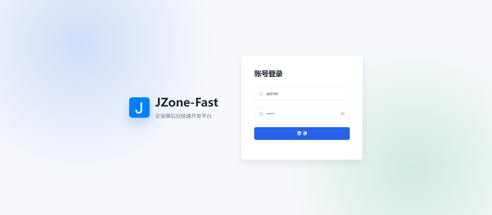
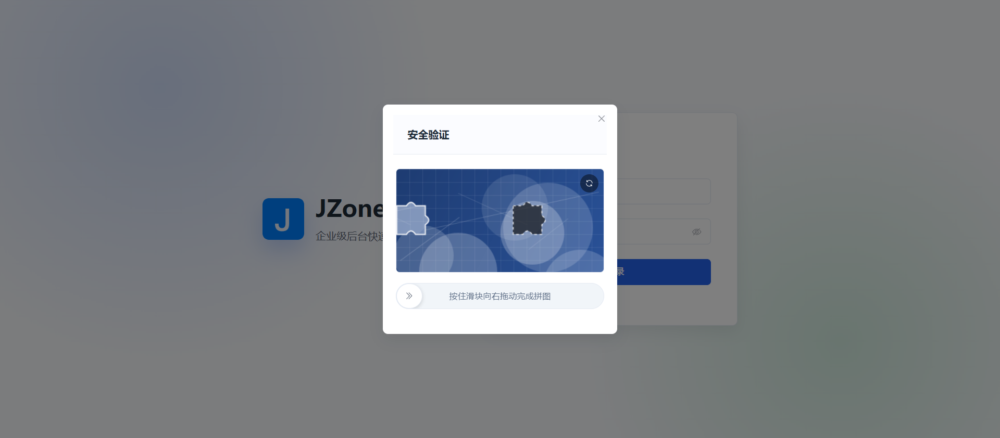
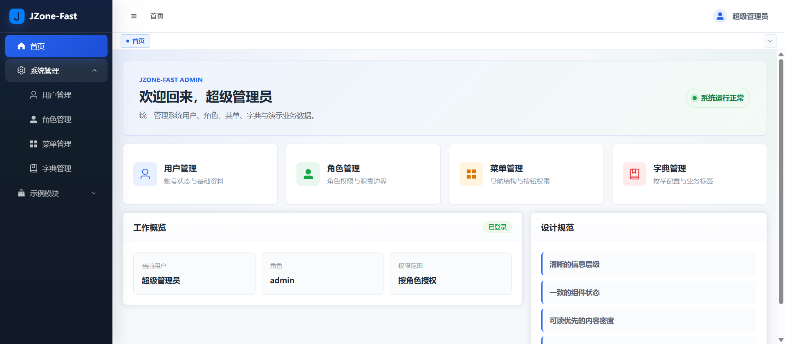
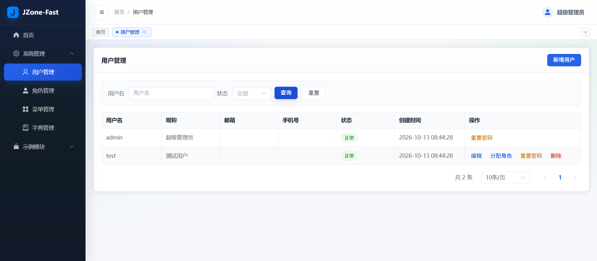
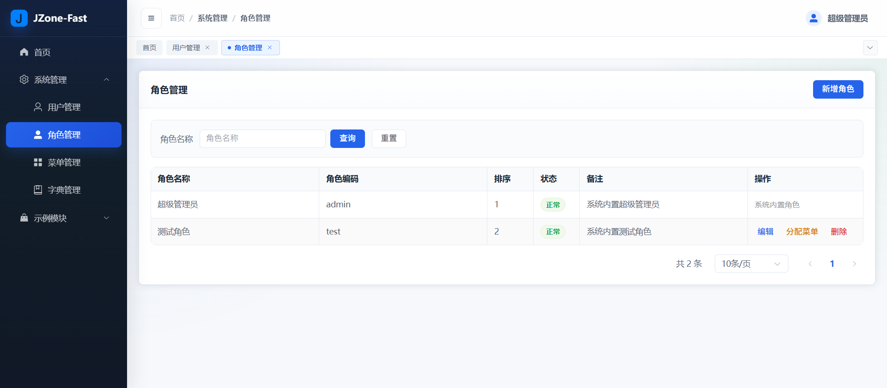
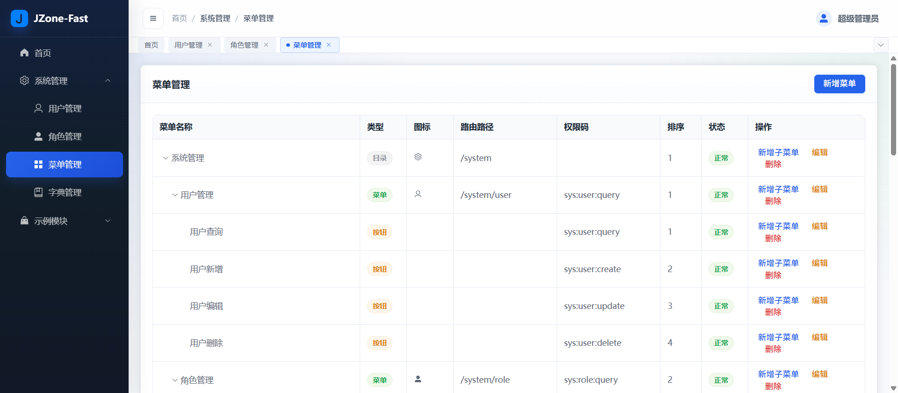
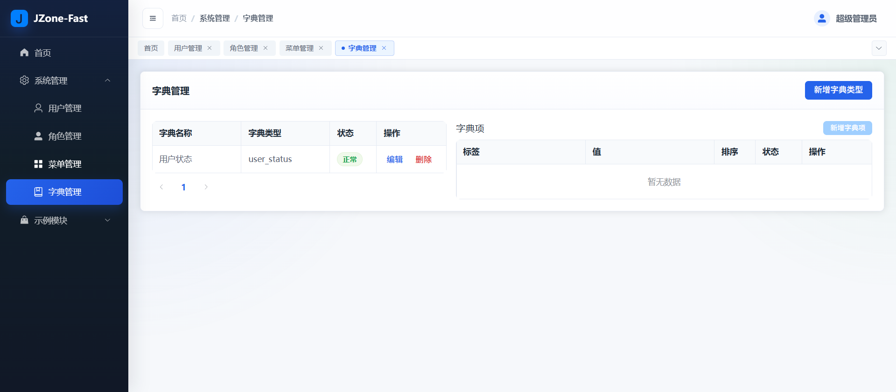
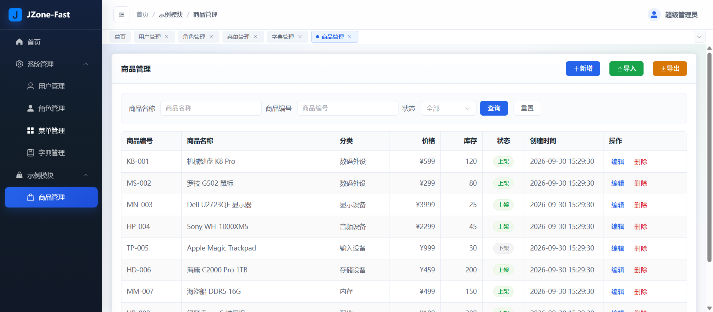
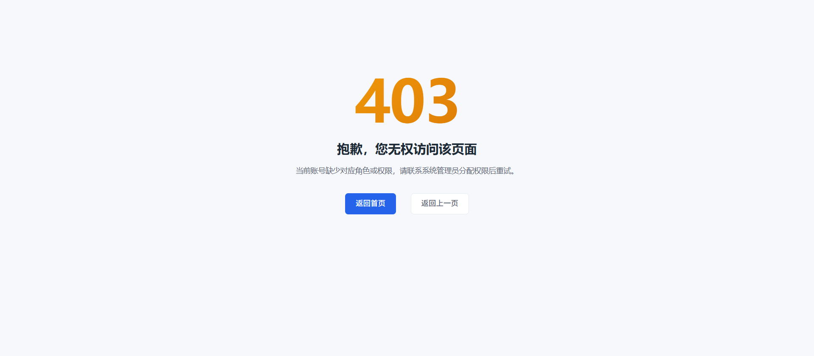
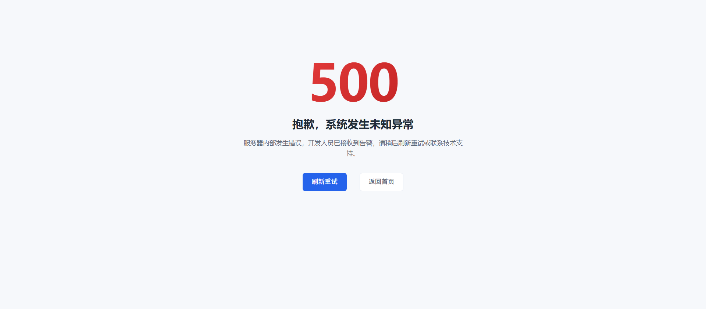

# JZone-Fast

<p align="center">
  <strong>Lightweight Java Rapid Development Scaffold / Minimalist MVP Framework</strong>
</p>

<p align="center">
  
  
  
  
  
  
  
</p>

---

## 1. Introduction

**JZone-Fast** is a lightweight, out-of-the-box rapid development scaffold tailored for small-to-medium teams and MVP (Minimum Viable Product) development.  
It aims for **minimal deployment overhead** and **maximum delivery speed** with a clean monolithic architecture and decoupled frontend/backend setup, avoiding redundant middleware complexity.

- [中文文档 (README.md)](./README.md)

### Key Features

- **Minimalist Architecture**: Lightweight single-module Spring Boot 3 + Vue 3 architecture, free from over-engineering, ready for rapid business delivery.
- **Out-of-the-Box RBAC Security**: Built-in **Sa-Token** security framework with support for user, role, dynamic menu tree, and button-level permission control (`v-auth`).
- **Comprehensive Security Hardening**: Built-in slider puzzle captcha, brute-force password attempt locking, and dynamic sorting SQL injection protection.
- **Standardized Response & Exception Handling**: Uniform `ResultBean<T>` response wrapper and global exception handler catching business validations, auth, and system errors.
- **Modern Interactive UX**: Hierarchical Breadcrumbs, TagsView multi-tab navigation, and stylish 403 / 404 / 500 error pages.
- **Automatic Auditing & In-Memory Cache**: Base entity with automatic audit field population and high-performance Caffeine cache for hot data reads.
- **Standardized Engineering Toolchain**: Configured ESLint + Prettier automated code quality inspection tools to ensure code consistency.
- **Complete Business Demo**: Production-grade product management sample covering pagination, status toggling, and Apache POI-based Excel import/export.

---

## 2. Preview Screenshots

| Account Login | Slider Puzzle Captcha |
| :---: | :---: |
|  |  |

| Dashboard (with Tabs & Breadcrumbs) | User Management |
| :---: | :---: |
|  |  |

| Role Management | Menu Management |
| :---: | :---: |
|  |  |

| Dictionary Management | Business Demo (Product Management) |
| :---: | :---: |
|  |  |

| 403 Forbidden | 500 Internal Error |
| :---: | :---: |
|  |  |

---

## 3. Tech Stack

### Backend

| Component | Version | Description |
| :--- | :--- | :--- |
| **Java** | 17+ | Long Term Support release with modern language features |
| **Spring Boot** | 3.2.5 | Modern enterprise core framework |
| **MyBatis-Plus** | 3.5.7 | Enhanced ORM & persistence layer |
| **MySQL** | 8.x | Relational database |
| **Sa-Token** | 1.38.0 | Lightweight Java authentication & authorization framework |
| **Caffeine** | 3.x | High-performance in-memory cache |
| **Hutool** | 5.8.26 | Comprehensive utility suite (string, collections, conversion) |
| **Apache POI** | 5.2.5 | Excel import and export processing |
| **Lombok** | 1.18.x | Boilerplate reduction |
| **BCrypt** | - | Strong password hashing via Spring Security Crypto |

### Frontend

| Component | Version | Description |
| :--- | :--- | :--- |
| **Vue** | 3.4+ | Progressive framework (Composition API & `<script setup>`) |
| **Vite** | 5.2+ | Next-generation frontend build tool |
| **Element Plus** | 2.7+ | Enterprise-grade UI component library |
| **Pinia** | 2.1+ | Intuitive lightweight state management |
| **Vue Router** | 4.3+ | Official router supporting dynamic route registration |
| **Axios** | 1.6+ | HTTP client with customized interceptors |
| **ECharts** | 5.5+ | Interactive charting and visualization library |
| **Sass** | 1.75+ | CSS preprocessor |

---

## 4. Modules & Features

```
JZone-Fast
├── System Management (System)
│   ├── User Management: CRUD, role assignment, password reset, status toggle
│   ├── Role Management: CRUD, menu & button permission tree allocation
│   ├── Menu Management: Directory, menu, and button permissions, dynamic route generation
│   └── Dictionary Management: Dict types and items with Caffeine caching
├── Demo Business (Demo)
│   └── Product Management: Product CRUD, category filtering, Excel import & export
└── Core Support
    ├── Unified authentication & security protection
    ├── Unified exception handling and standard API responses
    ├── Dynamic breadcrumbs & TagsView multi-tab navigation
    └── Button permission directive `v-auth`
```

---

## 5. Quick Start

### 5.1 Prerequisites

- **JDK**: 17 or higher
- **Maven**: 3.6 or higher (3.8+ recommended)
- **Node.js**: 18 or higher
- **MySQL**: 8.0 or higher

### 5.2 Database Setup

1. Create a MySQL database (character set `utf8mb4`, collation `utf8mb4_general_ci`):
   ```sql
   CREATE DATABASE `jzone-fast` DEFAULT CHARACTER SET utf8mb4 COLLATE utf8mb4_general_ci;
   ```
2. Execute the initialization SQL scripts:  
   File paths: `src/main/resources/db/init.sql` and `src/main/resources/db/demo.sql`

### 5.3 Backend Setup

1. Configure datasource connection:  
   Open `src/main/resources/application-dev.yml` and provide your MySQL credentials (or set environment variables `DB_USERNAME` and `DB_PASSWORD`):
   ```yaml
   spring:
     datasource:
       url: jdbc:mysql://localhost:3306/jzone-fast?useUnicode=true&characterEncoding=utf8&serverTimezone=Asia/Shanghai&allowPublicKeyRetrieval=true&useSSL=false
       username: root
       password: your_password
       driver-class-name: com.mysql.cj.jdbc.Driver
   ```
2. Compile and run the backend application:
   ```bash
   # In the project root directory
   mvn clean compile
   # Run the main class: com.jzone.JZoneFastApplication
   ```
   The backend server runs by default on port `8086`.

### 5.4 Frontend Setup

1. Navigate to the `web` directory and install dependencies:
   ```bash
   cd web
   npm install
   ```
2. Launch the Vite dev server:
   ```bash
   npm run dev
   ```
3. Open your browser:  
   Navigate to `http://localhost:5173`

### 5.5 Default Credentials

| Role | Username | Password | Note |
| :--- | :--- | :--- | :--- |
| **Super Admin** | `admin` | `admin` | Full administrative privileges |
| **Test Account** | `test` | `123456` | Standard user role for verifying role-based menu and button permission (`v-auth`) isolation |

---

## 6. Project Directory Layout

### Backend Structure

```text
src/main/java/com/jzone/
├── JZoneFastApplication.java            # Spring Boot main class
├── common/                              # Common layer (entities, constants, utils)
│   ├── constant/                        # Global constants
│   ├── pojo/                            # Base PO/DTO
│   └── util/                            # Pure utility classes
├── framework/                           # Core framework layer
│   ├── cache/                           # In-memory cache (Caffeine)
│   ├── exception/                       # Global exception handling
│   ├── mybatis/                         # MyBatis-Plus config & audit handler
│   ├── result/                          # Unified ResultBean wrapper
│   ├── satoken/                         # Auth configuration
│   └── web/                             # Web configuration
└── module/                              # Business module layer
    ├── demo/                            # Sample business modules (product)
    └── system/                          # System management modules
        ├── dict/                        # Dictionary management
        ├── login/                       # Authentication & security verification
        ├── menu/                        # Menu & permission management
        ├── role/                        # Role management
        └── user/                        # User management
```

### Frontend Structure

```text
web/
├── index.html
├── package.json
├── .eslintrc.cjs                        # ESLint configuration
├── .prettierrc                          # Prettier configuration
├── vite.config.js                       # Vite configuration
└── src/
    ├── api/                             # Unified API definitions
    ├── assets/                          # Static assets
    ├── components/                      # Reusable UI components
    ├── composables/                     # Reusable Vue composables
    ├── directives/                      # Custom directives (v-auth)
    ├── layout/                          # App framework layout
    ├── router/                          # Route definitions
    ├── store/                           # Pinia state stores
    ├── utils/                           # Helper utilities
    └── views/                           # Page views
        ├── dashboard/                   # Dashboard view
        ├── demo/product/                # Product management view
        ├── error/                       # Error fallback views
        ├── login/                       # Login view
        └── system/                      # System management views
```

---

## 7. Architecture & Conventions

1. **Unified Response**: All API endpoints return `ResultBean<T>` with `code`, `msg`, and `data`.
2. **Authentication & Authorization**: Protected by default via Sa-Token; pass `Authorization: <token>` in HTTP headers. Use `@SaCheckPermission("module:resource:action")` on controller methods and `v-auth` on frontend buttons.
3. **Deletion Strategy**: Hard deletion by default. Verify data relations and dependencies before deleting records.
4. **Pagination Pattern**: Query parameters extend `PageDTO`, and response pages are wrapped in `PageResult<T>`.
5. **Dependency Injection**: Use constructor injection via Lombok `@RequiredArgsConstructor` and `private final` fields. Avoid `@Autowired` field injection.
6. **Frontend Code Standards**: Run `npm run lint` and `npm run format` for automated syntax checks and code formatting.

---

## 8. Build & Deployment

### Backend Build
```bash
mvn clean package -DskipTests
# Executable jar will be generated at target/jzone-fast-1.0.0.jar
java -jar target/jzone-fast-1.0.0.jar --spring.profiles.active=prod
```

### Frontend Build
```bash
cd web
npm run build
# Production assets will be emitted to web/dist
```
Static frontend files can be deployed using Nginx, which can also reverse-proxy backend `/sys/` and business API requests.

---

## 9. License

This project is open-sourced under the [MIT License](./LICENSE).
